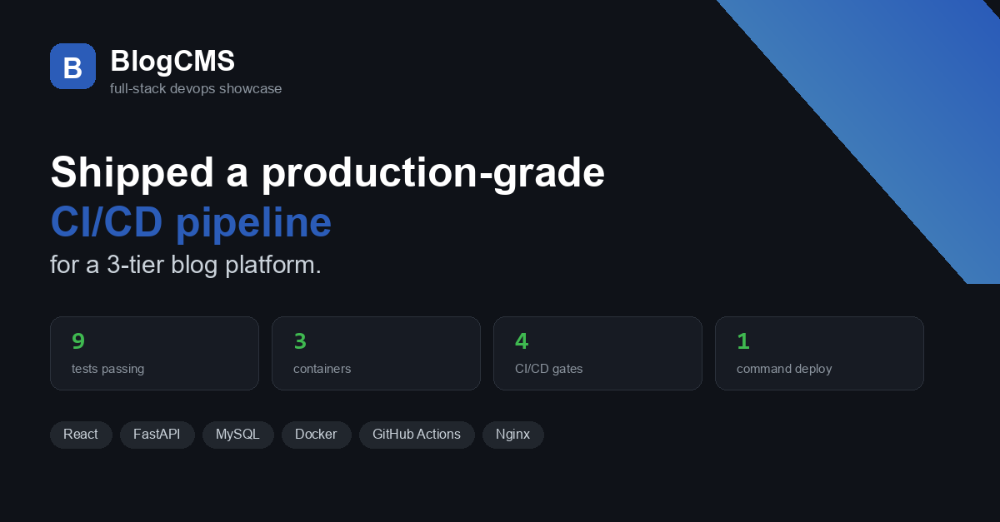

<div align="center">
  
</div>

# BlogCMS

### A 3-tier blog platform built to prove the whole DevOps lifecycle, not just the app.

[](https://github.com/OWNER/blog-cms/actions/workflows/ci-cd.yml)
[](backend/tests/test_api.py)
[](backend/app)
[](LICENSE)

**React · FastAPI · MySQL · Docker · GitHub Actions · Nginx**

| | |
|---|---|
|  |  |
| **Home** — published posts, search, category filter | **Post detail** — content, edit/delete, comments |

---

## Why this project exists

Plenty of portfolio projects stop at "it renders on localhost." This one goes
further and answers the question a reviewer actually cares about:

> *If I cloned this at 2am, could it actually reach production — and would I
> know if something broke?*

So the interesting engineering here isn't the blogging feature. It's the
**shipping path**: every service is containerized, every build is gated by
tests, and the whole stack comes up with a single command.

---

## Quick start

```bash
git clone https://github.com/OWNER/blog-cms.git
cd blog-cms
docker compose up --build
```

That's it — MySQL, the API, and the Nginx-served frontend all start together.

| Service | URL | Notes |
|---|---|---|
| Frontend | http://localhost | React build served by Nginx |
| API docs (Swagger) | http://localhost:8000/docs | Auto-generated OpenAPI UI |
| Health check | http://localhost:8000/api/health | Reports API + DB status |
| MySQL | localhost:3306 | `blog_user` / `blog_pass` / `blog_cms` |

> The **first account you register automatically becomes `admin`** — so register
> first, before anyone else claims the instance.

### With hot reload (local development)
```bash
docker compose -f docker-compose.yml -f docker-compose.dev.yml up --build
```
- Frontend (Vite dev server): http://localhost:5173
- Backend (auto-reload): http://localhost:8000

---

## Architecture

```
                    +------------------------------------------+
   Browser  ------> |  frontend  .  React (Vite) + Nginx :80   |
                    +-------------------+----------------------+
                                        |  /api/*  (reverse proxy)
                    +-------------------v----------------------+
                    |  backend   .  FastAPI + Uvicorn :8000     |
                    |  JWT auth . RBAC . SQLAlchemy ORM         |
                    +-------------------+----------------------+
                                        |  SQL (pymysql)
                    +-------------------v----------------------+
                    |  db        .  MySQL 8.0 :3306             |
                    +------------------------------------------+
                         all on a shared bridge network: blog-net
```

Nginx serves the compiled SPA and reverse-proxies `/api/*` to the backend, so
the browser only ever talks to one origin — no CORS surprises, and the
frontend and API stay independently deployable.

---

## Features

| Area | What it does |
|---|---|
| **Auth** | JWT register/login. First user auto-becomes `admin` |
| **Roles** | `admin` / `author` / `reader`, enforced on every write endpoint |
| **Posts** | Create, edit, delete, draft vs. publish, slug URLs |
| **Comments** | Per-post commenting; author or admin can delete |
| **Categories** | Create, tag posts, filter the feed by category |
| **Search** | Keyword search across post titles and content |
| **Health** | `/api/health` reports API + DB state for Docker and CI |
| **Docs** | Auto-generated OpenAPI/Swagger at `/docs` |

### Security details worth noting
- Passwords hashed with **bcrypt** (cost 12), never stored in plain text.
- Because bcrypt silently ignores input past 72 bytes, passwords are
  **SHA-256 pre-hashed and base64-encoded** first — so long passphrases are
  hashed in full instead of being truncated into collisions.
- JWTs signed with `HS256`; role checks happen server-side on every write,
  not just hidden in the UI.

---

## CI/CD pipeline

Defined in `.github/workflows/ci-cd.yml`, running on every push and PR to `main`.

```
    +-------+   +-------+   +-------+   +---------------+   +--------+
    | lint  |-->| test  |-->| build |-->| build & push  |-->| deploy |
    |       |   |       |   |       |   | Docker images |   |  hook  |
    +-------+   +-------+   +-------+   +---------------+   +--------+
        |           |           |              |
        +-----------+-----------+--------------+
         a failure here stops everything downstream
```

| Stage | What runs | Gate |
|---|---|---|
| **Lint** | flake8 (backend), ESLint (frontend) | must pass |
| **Test** | pytest against in-memory SQLite — no external services | must pass |
| **Build** | production `vite build` | must succeed |
| **Push** | multi-stage Docker images -> GHCR, tagged `latest` + commit SHA | on `main` only |
| **Deploy** | POSTs to the `DEPLOY_HOOK_URL` secret (Render / Railway / Fly) | on `main` only |

The important part is the ordering: **images are only built after lint, tests,
and the frontend build have all succeeded.** A broken change can never reach
the registry, let alone production.

Images are also built with **BuildKit layer caching**, so repeat builds skip
dependency installation.

---

## Testing

**9 automated tests**, all green, running against an in-memory SQLite database
so they need no external services and finish in seconds.

```bash
cd backend
pip install -r requirements.txt
pytest tests/ -v
```

Coverage spans the auth flow, role enforcement, draft visibility, and the
bcrypt edge case described above:

```
test_health_check                                PASSED
test_register_first_user_becomes_admin           PASSED
test_login_and_create_post                       PASSED
test_list_posts_is_public                        PASSED
test_duplicate_registration_fails                PASSED
test_long_password_is_hashed_without_truncation  PASSED
test_passwords_are_not_stored_in_plaintext       PASSED
test_role_permissions_are_enforced               PASSED
test_draft_posts_are_hidden_from_public_list     PASSED
```

---

## Project structure

```
blog-cms/
├── backend/                    # FastAPI service
│   ├── app/
│   │   ├── main.py             # App entrypoint, lifespan, health check
│   │   ├── models.py           # SQLAlchemy models
│   │   ├── schemas.py          # Pydantic request/response schemas
│   │   ├── auth.py             # JWT + bcrypt hashing + role guards
│   │   ├── database.py         # Engine/session setup
│   │   └── routers/            # auth, posts, categories, comments
│   ├── tests/test_api.py       # pytest suite (in-memory SQLite)
│   ├── requirements.txt
│   ├── Dockerfile
│   └── .dockerignore
├── frontend/                   # React (Vite) SPA
│   ├── src/
│   │   ├── pages/              # Home, Login, Register, PostDetail, PostEditor
│   │   ├── components/         # Header, PostCard, ProtectedRoute
│   │   ├── context/            # AuthContext
│   │   └── api/client.js       # Axios instance with JWT interceptor
│   ├── nginx.conf              # Serves SPA + proxies /api
│   ├── Dockerfile              # Multi-stage: Node build -> Nginx serve
│   └── .dockerignore
├── demo/                       # Automated demo capture + showcase assets
│   ├── run_demo.py             # Playwright screenshots -> .docx report
│   └── make_showcase.py        # Generates banner + LinkedIn carousel images
├── docs/                       # Waterfall-model project documentation
├── assets/                     # Banner + carousel images used above
└── .github/workflows/ci-cd.yml
```

---

## Documentation

Full project documentation, written in Waterfall-model structure:

- [`docs/01-requirements.md`](docs/01-requirements.md) — scope, functional & non-functional requirements
- [`docs/02-system-design.md`](docs/02-system-design.md) — data model, API design, architecture decisions
- [`docs/03-implementation.md`](docs/03-implementation.md) — how each module was built
- [`docs/04-testing.md`](docs/04-testing.md) — test strategy, cases, CI gates, limitations
- [`docs/05-deployment-maintenance.md`](docs/05-deployment-maintenance.md) — deployment paths and runbooks

---

## Tech stack

| Layer | Technology | Why |
|---|---|---|
| Frontend | React 18 + Vite | Fast dev server, small production bundle |
| Backend | FastAPI | Async-ready, typed, automatic OpenAPI docs |
| Database | MySQL 8.0 | Real relational modelling; production-representative |
| Auth | JWT (`python-jose`) + bcrypt | Stateless tokens, passwords never stored raw |
| Containerization | Docker + Compose | Reproducible, environment-independent |
| CI/CD | GitHub Actions | Lint -> test -> build -> push -> deploy |
| Web server | Nginx | Static serving, gzip, API reverse proxy |

---

## Configuration

Copy the example env files and adjust as needed:

```bash
cp backend/.env.example backend/.env
cp frontend/.env.example frontend/.env
```

| Variable | Where | Purpose |
|---|---|---|
| `DATABASE_URL` | backend | SQLAlchemy connection string |
| `JWT_SECRET_KEY` | backend | Signs JWTs — **change this in production** |
| `ACCESS_TOKEN_EXPIRE_MINUTES` | backend | Token lifetime |
| `VITE_API_URL` | frontend | Leave blank to use the Nginx `/api` proxy |

---

## Deployment

Any Docker-capable host works — Render, Railway, Fly.io, an EC2 instance, or
a Kubernetes cluster.

Set `DEPLOY_HOOK_URL` as a repository secret and pushes to `main` deploy
automatically. Without it, deploy manually:

```bash
docker compose pull && docker compose up -d
```

> Set a strong random `JWT_SECRET_KEY` in production. Never deploy with the
> default from `.env.example`.

---

## License

MIT — see [LICENSE](LICENSE).
Manual/exploratory test cases are documented in
[`docs/04-testing.md`](docs/04-testing.md).# blog-cms
